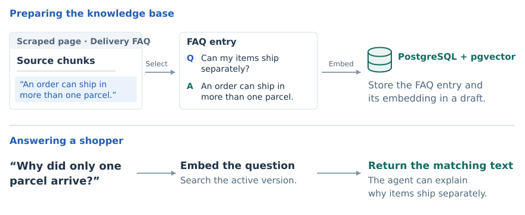
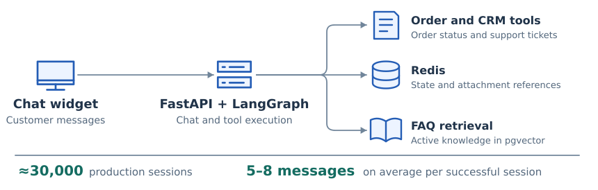
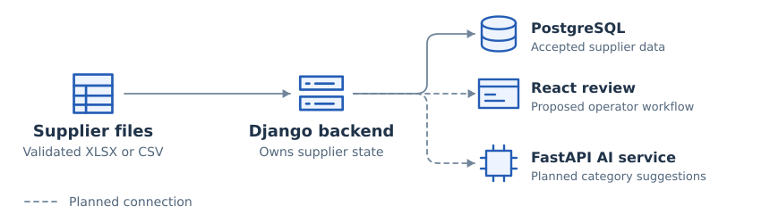

# AI engineering for retail

A shopper can ask our production support assistant where an order is or whether delivery is available to a particular postcode. As a **student AI/ML engineer**, I developed order tools and built the **knowledge base API** the team uses to publish answers to delivery questions. On a second team, I connected supplier price lists to the backend that maintains the product catalog.

<picture>
  <source media="(max-width: 600px)" srcset="assets/engineering-path-mobile.svg">
  
</picture>

**Figure 1.** My responsibilities on the support and catalog teams in 2026.

I rejoined the team in January after my Erasmus semester at Polytech Tours. I started by improving the data returned by individual tools. Later I took responsibility for publishing the knowledge those tools use across conversations. I had regular one-to-ones with my mentor and with our engineering manager.

## How a web page becomes a chat answer

I scraped support pages and turned their text into question-and-answer entries for the assistant. For long pages, I split the text into chunks so an answer could retain the source wording. I stored the entries with their embeddings in **PostgreSQL** and used **pgvector** to search the version our team had approved.

<picture>
  <source media="(max-width: 600px)" srcset="assets/rag-example-mobile.svg">
  
</picture>

**Figure 2.** An illustrative delivery FAQ. The shopper asks a different question from the one stored in the FAQ. The assistant can use the matching source text to explain why items might arrive separately.

The **FastAPI** knowledge base API I built lets an operator review the draft before activating it. While that review is underway, the assistant keeps searching the previous release.

## How I evaluated a support conversation

The **JavaScript** chat widget sends the shopper’s message to FastAPI. **LangGraph** resumes the conversation and **Redis** keeps the order context available for follow-up questions. I adapted the widget’s connection to the backend and changed how the order tool represents shipments, so the assistant can explain the status of each parcel.

<picture>
  <source media="(max-width: 600px)" srcset="assets/support-runtime-mobile.svg">
  
</picture>

**Figure 3.** The assistant handled about 30,000 production sessions. Successful sessions averaged roughly 5–8 messages.

I used **OpenTelemetry** to export request traces and reviewed them in **Arize Phoenix**. If the tool returns two shipments but the reply mentions only one, comparing the two steps helps me locate where the information was lost.

[Support assistant architecture, retrieval and trace review](cases/support-assistant.md)

## How supplier files reach the catalog

Suppliers use different column names and file formats. I built the **Python** intake that maps price lists to a common product record and connected it to a teammate’s **Django** service. The service can accept a complete file or keep the previous catalog if validation fails.

<picture>
  <source media="(max-width: 600px)" srcset="assets/catalog-system-mobile.svg">
  
</picture>

**Figure 4.** The solid connections show how validated products reach PostgreSQL. Dashed connections show the planned operator review and AI suggestions.

[Catalog architecture and my work with the backend team](cases/catalog-intake.md)

## What I want to work on next

I want to compare retrieval changes on the same set of customer questions and trace how a change affects the final answers. I’d also like to keep building APIs that other teams can use to review and release those changes.
