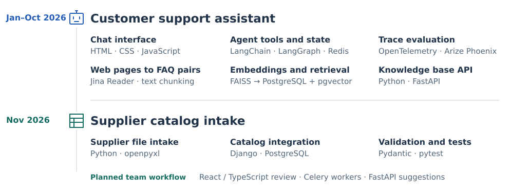

# AI engineering for retail

I worked on two retail systems as a **student AI/ML engineer**. For a production support assistant, I developed order tools, evaluated conversations and built the **knowledge base API**. On the catalog team, I connected supplier data to the backend that maintains product records.

<picture>
  <source media="(max-width: 600px)" srcset="assets/engineering-path-mobile.svg">
  
</picture>

**Figure 1.** My work across two projects in 2026, with the technologies I used for each responsibility.

I rejoined the team in January after my Erasmus semester at Polytech Tours. My first assignments involved the data returned by a single tool. Later I was responsible for how the team published knowledge used across conversations. Alongside my project work, I had regular one-to-ones with my mentor and with our engineering manager.

## Customer support in production

A shopper can ask where an order is and then follow up about a particular delivery. I worked on the **LangGraph** tools that return the status of each shipment and used **Redis** to carry the order context across messages.

<picture>
  <source media="(max-width: 600px)" srcset="assets/support-runtime-mobile.svg">
  
</picture>

**Figure 2.** The assistant handled about 30,000 production sessions. Successful sessions averaged roughly 5–8 messages.

I evaluated replies in **Arize Phoenix** by following **OpenTelemetry** traces from the tool call to the final answer. I also built the **FastAPI** routes that operators use to prepare, review and activate a new knowledge version while chat continues to serve the current one.

[Support assistant architecture and knowledge releases](cases/support-assistant.md)

## Supplier catalog intake

The catalog team needed a common way to read price lists from different suppliers. I built the **Python** intake and connected it to a teammate’s **Django** service so the team could validate product records before accepting them into the catalog.

<picture>
  <source media="(max-width: 600px)" srcset="assets/catalog-system-mobile.svg">
  
</picture>

**Figure 3.** Supplier intake was my part of the system. The dashed connections show the team’s planned review and AI workflow.

[Catalog architecture and teamwork](cases/catalog-intake.md)

## What I want to work on next

I want to get better at evaluating how changes to retrieval affect an agent’s answers. These projects also made me want to keep building the APIs behind those tools, especially when another team depends on the data they return.
