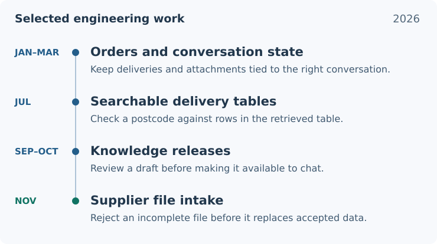

# AI engineering in customer support and catalog intake

A customer asking about an order needs an answer that accounts for each delivery. A catalog operator importing a supplier’s price list needs to know whether every row was read. I worked on both problems as a student AI/ML engineer. On the support team, I worked on how the assistant kept track of a conversation and searched its knowledge base. On the catalog team, I built the spreadsheet parser and connected it to the service that stores accepted supplier data.

## How my work changed

I returned from my Erasmus semester at Polytech Tours in January 2026 and rejoined the team after my AI engineering internship the previous summer. The support assistant was already in development. My first changes dealt with the data its tools returned. By autumn, I was working on how the team could review, activate and roll back the knowledge used across conversations.

<picture>
  <source media="(max-width: 600px)" srcset="assets/engineering-timeline-mobile.svg">
  
</picture>

**Figure 1.** Selected changes during my student role. The first three stages belong to the support assistant. The November work was on a separate team project for supplier catalogs.

## Conversational AI Support Platform

A customer might ask, “Do you deliver to my postcode?” The knowledge base can contain both a list of delivery areas and a list of areas with an extra charge. Finding a relevant table is only half the job. An absent postcode means something different in each list.

I added structured retrieval for these tables. The FAQ tool finds a relevant document using vector search, then Python checks the postcode against the rows and interprets it according to the table type. I later moved retrieval from a local FAISS index to versioned records in PostgreSQL with pgvector. That let the team prepare a new knowledge release while the assistant continued answering from the active one.

[Case study: conversation state, table retrieval and knowledge releases](cases/support-assistant.md)

## Catalog Intake Workbench

A spreadsheet can open successfully and still declare a used range smaller than the data it contains. If the reader trusts that range, it can produce a plausible list of products with the last rows missing. Using that list as a complete replacement could remove valid products from the supplier’s accepted state.

I fixed the XLSX reader for this case and wrote regression tests for incomplete imports. A teammate had built the Django service that stores the accepted state. I connected my parser to that service through a development command. It passes articles to the service only after the whole file clears validation.

[Case study: reading supplier files and protecting accepted data](cases/catalog-intake.md)
