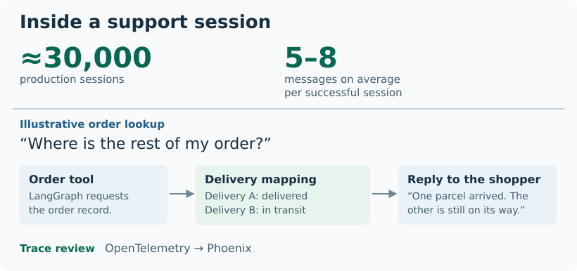
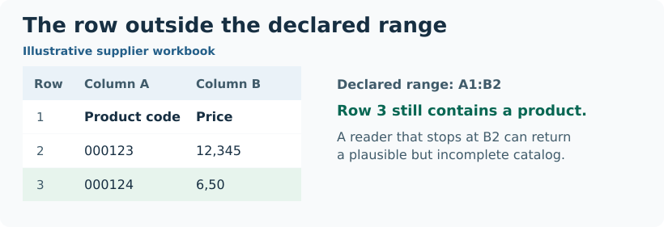

# AI engineering for customer support and catalog intake

A customer can ask our support assistant where the rest of an order is, even when the order arrives in several deliveries. I started by improving the order data its tools returned. As my responsibilities grew, I added conversation state in Redis, evaluated replies in Phoenix and built controls for releasing new FAQ content. On a second team, I built a spreadsheet parser that protects a supplier’s catalog from incomplete imports.

I returned from my Erasmus semester at Polytech Tours in January 2026 and rejoined the team as a **student AI/ML engineer** after my internship the previous summer.

## What happens inside a support conversation

The assistant handled **about 30,000 sessions in production**. Successful sessions averaged roughly **5–8 messages**. To evaluate an answer, I followed its OpenTelemetry trace in **Arize Phoenix**. That let me compare the reply the customer received with the tool the agent called and the data that tool returned.

<picture>
  <source media="(max-width: 600px)" srcset="assets/support-session-mobile.svg">
  
</picture>

**Figure 1.** An illustrative split order. The order tool provides a status for each delivery so the assistant can explain why one parcel arrived before the other.

My first assignments involved individual tools. Fixing a status mapping helped with one answer, but a follow-up question also needed the right order and attachments to survive across turns. I added conversation-scoped storage in **Redis** and worked on call limits in the **LangGraph** runtime. Later I moved FAQ retrieval from a local **FAISS** index to versioned knowledge in **PostgreSQL with pgvector**. I built controls that let an administrator inspect a draft and decide when chat should use it.

[Support assistant architecture, trace review and knowledge releases](cases/support-assistant.md)

## When a spreadsheet silently drops a product

On the catalog project, a file could open successfully and still report a used range smaller than its contents. A reader that trusted that range could hand the team a plausible list with the last product missing. In a full import, a missing product could be marked inactive.

<picture>
  <source media="(max-width: 600px)" srcset="assets/workbook-range-mobile.svg">
  
</picture>

**Figure 2.** The declared range ends at row 2. The product in row 3 is still part of the supplier’s file.

I fixed how the **Python** parser reads these workbooks and connected it to a teammate’s **Django** service. I wrote regression tests for a shortened product list and for an invalid row in an otherwise valid file. In both cases, the previously accepted catalog has to survive.

[Catalog architecture, parser behaviour and regression tests](cases/catalog-intake.md)
