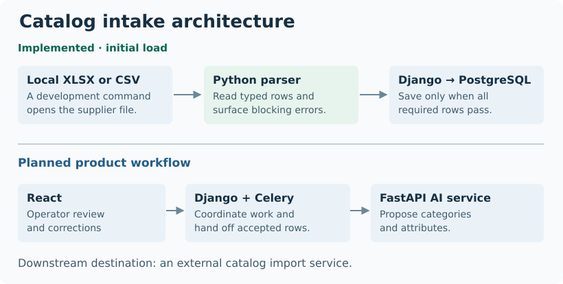

# Catalog Intake Workbench

A supplier’s spreadsheet becomes the starting point for a catalog import. If a product disappears from a full import, it may be marked inactive downstream. In November 2026 I built the Python parser for known XLSX and CSV layouts and connected it to the team’s existing Django service for loading an initial catalog.

[Overview](../README.md)

## Where my parser fits

<picture>
  <source media="(max-width: 600px)" srcset="../assets/catalog-architecture-mobile.svg">
  
</picture>

**Figure 1.** The upper path runs through a development command. The lower section shows the intended product workflow, including operator review and AI suggestions.

A teammate built the data model and initial-state service. My parser finds the header, maps columns by name and returns typed articles with row diagnostics. The development command calls the service only when it has a complete set of valid articles. That boundary lets the parser report a bad file without writing to PostgreSQL.

## Two failures worth testing

**A workbook hides its last row.** Some XLSX files declare a used range smaller than the data in the worksheet. I fixed the reader and added a regression test for a file whose declared dimensions would produce a shortened list. The test checks that the shortened list cannot replace the existing state. [Illustrative worksheet](../README.md#when-a-spreadsheet-silently-drops-a-product).

**A valid row sits next to a broken one.** A parser that skips an unreadable price can return perfectly valid articles for the remaining products. I added a test that starts with an accepted catalog and introduces one blocking row. The expected outcome is that the previous catalog stays intact.

| Field in a synthetic supplier file | What the parser should do |
| --- | --- |
| Text product code `000123` | Keep the leading zeros so the code still identifies the same product. |
| Price `12,345` in a decimal-comma format | Preserve the decimal value `12.345`. |
| Unreadable numeric cell | Identify the problem row and stop the replacement. |

I used **openpyxl** for workbooks and Python’s CSV reader for delimited files. I also added Linux subprocess limits for time, memory and output size. Targeted parser and normalization tests passed in the development review. The Linux subprocess tests were skipped on Windows.

## What the wider team designed

The product design gives **Django** ownership of catalog state and **Celery** workers responsibility for background jobs. A separate **FastAPI** service is intended to suggest categories and attributes for operator review in **React**. The parser and loader were implemented on a feature branch. The user-facing upload, AI suggestion and external import steps had yet to be connected into a complete workflow in that version.
