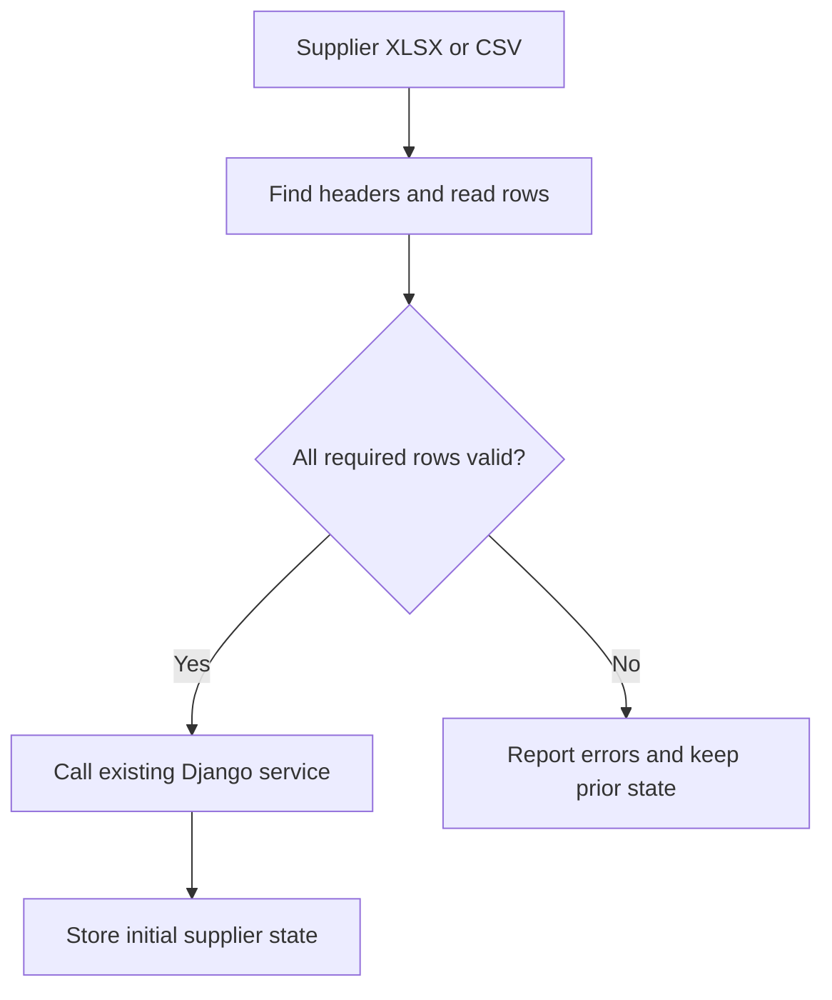

# Catalog Intake Workbench

Suppliers send price lists with different headings, price formats and product codes. In November 2026 I implemented the Python parser that reads known XLSX and CSV formats into typed articles. I connected it to an existing Django service so the team could load an initial supplier catalog from a local file.

[Overview](../README.md)

## A file can look complete and still lose data

Some workbooks declare a used range that ends before the last product row. A reader that relies on that range can silently drop products. I fixed the reader and added a regression case for an undersized range. I also handled headers below introductory text and added diagnostics for unreadable numeric cells.

The parser preserves text identifiers and decimal prices. In this synthetic example, a supplier uses a comma as the decimal separator.

| Spreadsheet field | Input | Expected interpretation |
| --- | --- | --- |
| Product code stored as text | `000123` | Keep all six characters so it still refers to the same product. |
| Price | `12,345` | Read the decimal value `12.345` using the supplier format. |
| Price in a second product row | Invalid numeric value | Report the row and prevent a partial replacement. |

## Where the parser meets the team’s backend

The parser returns articles and diagnostics. A teammate implemented the data model and initial-state service. I wrote the development command that joins the two. Its validation step requires a complete set of articles before it calls the service.

**Figure 1.** Both paths start with the same supplier file. A blocking error stops the command before it can write a shortened product list.

I added tests for a blocked row in an otherwise valid file and for a workbook whose declared dimensions hide data. Both address the same downstream risk. A full import can treat omitted products as inactive. I also added Linux subprocess limits for parsing time, memory and output size so one unusually large file could not occupy the parser indefinitely.

## How this fits into the wider product

The team designed a larger workflow in which Django manages an import and a separate FastAPI service proposes categories, attributes and descriptions for review. The part I implemented runs through a development command on a feature branch. The end-to-end upload, AI suggestion and external import flow was still planned in the version described here.

Targeted parser and normalization tests passed in the development review. The Linux subprocess tests were skipped on Windows, and the database integration suite was not rerun in that review.
