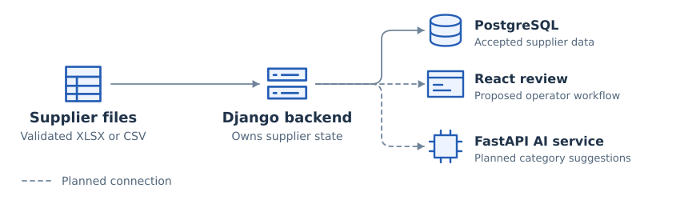

# Catalog Intake Workbench

Suppliers send price lists in different formats. Our team designed a workbench where an operator could review product updates before sending them to an external catalog. I built the Python intake for XLSX and CSV files and connected it to the team’s Django backend.

[Overview](../README.md)

## How the system fits together

<picture>
  <source media="(max-width: 600px)" srcset="../assets/catalog-system-mobile.svg">
  
</picture>

**Figure 1.** The initial load takes validated products from a supplier file into Django. The dashed connections show the proposed review and AI workflow.

The **Django** backend stores accepted product records in **PostgreSQL**. In the team’s design, operators would review changes in **React**. **Celery** would coordinate background jobs and a separate **FastAPI** service would suggest product categories and attributes.

## My contribution

A teammate built the service that stores the accepted catalog. I mapped supplier columns to the typed product records that service expects. I added tests to check that an incomplete file leaves the previously accepted catalog intact.
