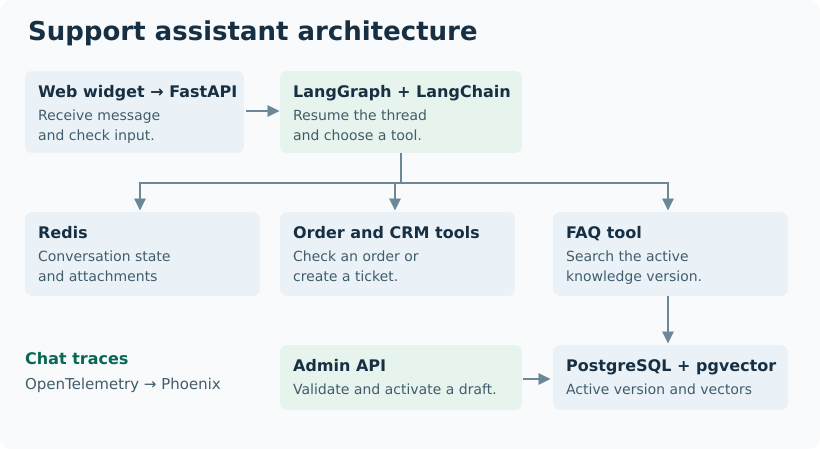
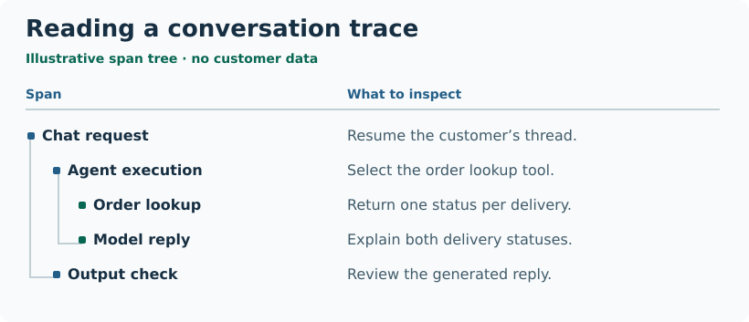

# Conversational AI Support Platform

A shopper can ask about delivery, check an order or attach a photo to a support request. I worked on the team’s existing production assistant from January through October 2026. My work grew from fixing individual tool responses to following a request across services and managing which knowledge version the assistant searched.

[Overview](../README.md)

## Where a chat request goes

<picture>
  <source media="(max-width: 600px)" srcset="../assets/support-architecture-mobile.svg">
  
</picture>

**Figure 1.** The chat service reads the active knowledge version. The admin service can prepare and validate its replacement while conversations continue.

The web widget sends the message and conversation ID to **FastAPI**. After the input check, **LangGraph** resumes the thread and the model can call a **LangChain** tool. An order tool retrieves business data, Python checks the relevant rules and the model explains the result. The final reply goes through an output check before it returns to the widget.

An order can have more than one shipment. I worked on mapping order, payment and warehouse statuses so each delivery retained its own status. I also added **Redis** storage for attachments. A shopper can send a photo before a support ticket exists. Once the ticket is created, a tool can use the stored ticket ID and attachment reference to send the right photo to the CRM.

## How I evaluated a reply in Phoenix

I reviewed **OpenTelemetry** traces in **Arize Phoenix** to evaluate the assistant’s behaviour across a request. I worked on exporting traces in batches. For an order question, the useful comparison was between the customer’s request, the tool call, its result and the final reply.

<picture>
  <source media="(max-width: 600px)" srcset="../assets/trace-review-mobile.svg">
  
</picture>

**Figure 2.** A trace helps locate a bad answer. If the order tool returns two deliveries but the reply mentions only one, the discrepancy appears after the lookup. This is a schematic example.

A retry matters more when a call creates a ticket than when it reads an order. I added separate limits for model calls and ticket creation. I also worked on fallback models and summarisation so longer conversations could carry forward the order context.

## When the right document still gives the wrong answer

Suppose a shopper asks whether delivery is available to postcode 12345. The FAQ tool embeds the question and uses **pgvector** to search the active knowledge version. A delivery-area table and a surcharge table can both look relevant to vector search. An absent postcode on a surcharge list tells us nothing about delivery availability.

I added table types and structured rows so Python could interpret the match. For supported tables, the tool locates the postcode column and checks its rows. If the postcode or table type is unclear, it returns the broader table context. The retrieval step finds a source. The row check determines what the assistant can say from it.

## Changing what the assistant knows

I worked on migrating the **FAISS** baseline into PostgreSQL and moving the runtime search to the active version. I then connected three parts of a release:

1. **Build.** For long source documents, the model selects source blocks. The application assembles the answer from their original text.
2. **Review.** Checks compare table headers and row counts with the source. A successful build produces a draft that an administrator can inspect.
3. **Activate.** The admin API changes the active version in a database transaction. I fixed reactivation of archived versions so an administrator could restore previously reviewed content.

A teammate separated the admin and chat applications and added session login. My contribution covered the versioned data, retrieval, build checks and controls that let the team choose which release customers would see.
