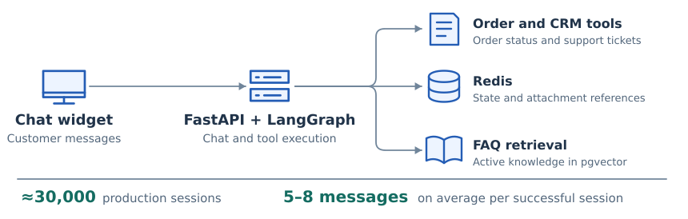
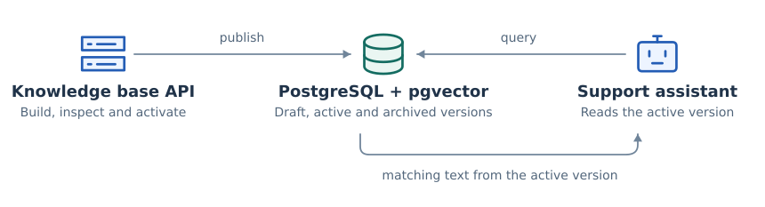

# Conversational AI Support Platform

A shopper can track an order, follow up about a delivery or start a support request. From January through October 2026, I worked on the tools behind those conversations and built the API our team used to publish new knowledge.

[Overview](../README.md)

## Following a conversation

<picture>
  <source media="(max-width: 600px)" srcset="../assets/support-runtime-mobile.svg">
  
</picture>

**Figure 1.** The web widget sends the message to FastAPI. LangGraph resumes the conversation and the model can ask a tool for the data it needs.

**Order context.** I mapped shipment statuses separately so an answer about one parcel would not be mistaken for the status of the whole order. I used Redis to keep order context and attachment references available across messages.

**Trace review.** I used OpenTelemetry to export request traces to Arize Phoenix. Each trace let me follow the model and tool calls behind a single reply. For example, if the order tool returns two shipments but the final reply mentions only one, I can inspect how the model used the tool result.

## Building the knowledge base API

I built the FastAPI routes for preparing, inspecting and activating knowledge versions. I also built the review interface that calls those routes. A teammate separated the admin and chat services and added login.

<picture>
  <source media="(max-width: 600px)" srcset="../assets/knowledge-release-mobile.svg">
  
</picture>

**Figure 2.** An operator can review a draft while the assistant searches the active version. Restoring an earlier release changes which entries the next query can retrieve.

## From source text to a reply

For longer documents, the build splits source text into chunks. The model selects the relevant chunks and the application uses their original text to form an FAQ entry. An embedding model then converts the entry’s search text into a vector. I migrated the earlier FAISS index into **PostgreSQL with pgvector** so each entry and its embedding belong to a specific knowledge version.

When a shopper asks about delivery, the FAQ tool embeds the question and searches for the closest entries in the active version. Vector search can find the right table, but the type of table determines what the assistant can conclude. I added a row lookup for supported postcode tables because a postcode missing from a surcharge list tells us nothing about whether delivery is available.
