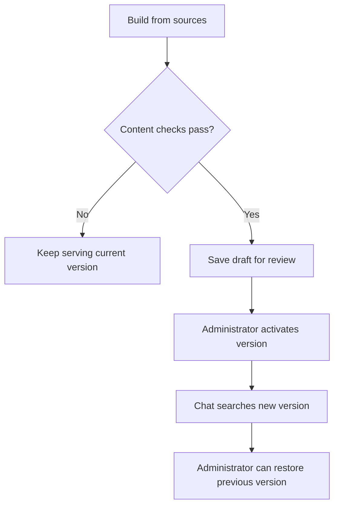

# Conversational AI Support Platform

A shopper can ask about delivery, check an order or attach a photo to a support request. I worked on this team’s existing assistant from January through October 2026. I started with order and payment data, then worked on conversation state, tool-call limits and the knowledge release process.

[Overview](../README.md)

## Keeping track of an order across messages

One order can have several deliveries. I worked on translating order and warehouse statuses into a response that keeps those deliveries separate. The model explains the result to the customer. The application checks eligibility for a return or change against the order data.

A support request can also span several messages. A shopper might send a photo before a ticket exists. I added Redis storage for attachments and tied each reference to its conversation. When the ticket is created, the application keeps its identifier so a tool can attach the photo to the right ticket later. The assistant works with a reference to the photo.

## Following a tool call

FastAPI receives the message and LangGraph resumes the conversation. I added limits on model calls and a separate counter for ticket creation because repeated attempts to write to the ticketing system have different consequences from repeated lookups. I also worked on fallback models and summarisation for longer conversations. I worked on batch trace export with OpenTelemetry and Phoenix so I could follow the model and tool steps within a request and see where a retry or failure occurred.

## Finding a document and checking a value

Consider the illustrative question “Is delivery available to postcode 12345?” The FAQ tool embeds the question and searches the active knowledge version in PostgreSQL with pgvector. For a supported table, it extracts the postcode and checks the corresponding rows.

| Retrieved table | What the tool can conclude |
| --- | --- |
| Delivery areas | A matching row supports an answer about availability for that postcode. |
| Areas with an extra charge | A missing row gives no evidence that delivery is available. |

I added table types and structured rows so that the application could make that distinction. When it cannot identify the postcode or interpret the table reliably, it returns the broader table context.

## Releasing knowledge while chat is running

The earlier retrieval path used a local FAISS index. I worked on migrating the baseline into PostgreSQL and switching the FAQ tool to the active version. For longer source documents, the model selects source blocks and the application assembles the answer from those blocks. This keeps the original wording available for review.

**Figure 1.** A successful build creates a draft. An administrator decides when conversations start using it.

I contributed the build and activation API, validation checks and the interface for reviewing and activating versions. For example, the build checks table headers and row counts before a draft can be created. Activation changes the active version in a database transaction. I later fixed reactivation of an older version so the team could return chat to previously reviewed content.

A teammate separated the admin and chat applications and added session login. My part was connecting the storage, build checks and operator controls that govern what the assistant can retrieve.
